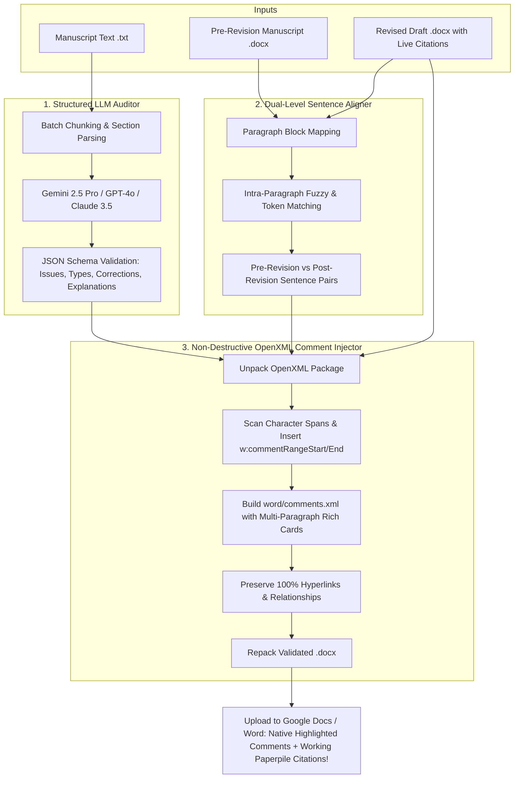

# Manuscript Audit Toolkit 🔬📑

[](https://www.python.org/downloads/)
[](https://opensource.org/licenses/MIT)
[](https://en.wikipedia.org/wiki/Office_Open_XML)

An automated, non-destructive scientific auditing and peer-review pipeline for academic manuscripts. It performs rigorous line-by-line checks for AI artifacts, mathematical inconsistencies, and nomenclature errors, performs sentence-level pre/post revision alignment, and injects native, highlighted sidebar comments directly into `.docx` (Google Docs & Microsoft Word) while **100% preserving live reference manager linkages** (Paperpile, EndNote, Zotero).

---

## 🎯 The Core Problem Solved

When auditing or heavily revising academic manuscripts (e.g., using AI rewrites, co-author merges, or journal revision responses), researchers face three major engineering hurdles:

1. **Reference Manager Corruption**: Standard programmatic document tools (`pandoc`, naive `python-docx` scripts, regex converters) wipe out `<w:hyperlink>` elements and Word Field Codes (`ADDIN EN.CITE`). This breaks live citation databases (e.g., Paperpile's `https://paperpile.com/c/...` cloud IDs, EndNote XML records, Zotero bookmarks), turning interactive bibliographies into unformattable plain text.
2. **Google Docs API Limitations**: Google Workspace APIs (`Drive.Comments.create`, Google Apps Script) **do not support anchoring comments to text ranges** in Google Docs. Third-party scripts can only insert document-level (unanchored) comments.
3. **Loss of Historical Context**: When co-authors or PIs review a revised manuscript, they need to see what the sentence looked like *before* the revision, what the *revised draft* says, what the *specific correction* is, and *why*.

---

## 🏗️ Architecture & Workflow



---

## 📦 Installation

```bash
git clone https://github.com/gf777/manuscript-audit-toolkit.git
cd manuscript-audit-toolkit
pip install -e .
```

Set your API key (if using the automated LLM auditor):
```bash
export GEMINI_API_KEY="your-api-key-here"
```

---

## 🚀 Quickstart Guide

### 1. Run Full End-to-End Pipeline
Run an audit on `draft.txt`, align against `original_v1.docx`, and generate `audited_review.docx`:
```bash
manuscript-audit pipeline \
  --input-txt manuscript.txt \
  --doc manuscript_draft.docx \
  --pre-revision manuscript_v1.docx \
  --output-docx audited_manuscript.docx
```

### 2. Step-by-Step Modular Workflow

#### Step A: Run the Line-by-Line Audit
```bash
manuscript-audit audit \
  --input manuscript.txt \
  --output audit_results.json \
  --model gemini-2.5-pro
```

#### Step B: Inject Sentence-Level Comments into DOCX
```bash
manuscript-audit inject \
  --doc manuscript_draft.docx \
  --audit-results audit_results.json \
  --pre-revision manuscript_v1.docx \
  --output audited_manuscript.docx
```

#### Step C: Open in Google Docs or Word
1. Upload `audited_manuscript.docx` to Google Drive.
2. Right-click $\rightarrow$ **Open with $\rightarrow$ Google Docs**.
3. Every audited line will highlight in yellow and display a sidebar comment containing:
   * **`[Audit Line X (Section)]`**
   * **`PRE-REVISION ORIGINAL:`** `"..."` (sentence from pre-revision draft)
   * **`CURRENT DRAFT TEXT:`** `"..."` (sentence in current draft)
   * **`SUGGESTED CORRECTION:`** `"..."` (recommended scientific edit)
   * **`EXPLANATION:`** Detailed rationale.
4. Click **Paperpile $\rightarrow$ Format citations** or use your Word EndNote/Zotero toolbar—all live links work seamlessly.

---

## 🐍 Python API Usage

```python
from manuscript_audit import ManuscriptAuditor, OpenXMLCommentInjector

# 1. Audit manuscript lines
auditor = ManuscriptAuditor(model="gemini-2.5-pro")
audit_results = auditor.run_full_audit("manuscript.txt", output_json="audit_results.json")

# 2. Inject native comments with pre-revision comparisons
injector = OpenXMLCommentInjector("draft_with_citations.docx")
injector.inject_audit_comments(
    audit_results=audit_results,
    output_docx_path="audited_final.docx",
    pre_revision_docx_path="original_pre_revision.docx"
)
```

---

## 🔍 Technical Deep-Dive: Why Non-Destructive OpenXML Matters

### How Paperpile Citations are Structured
In Word/Google Docs, Paperpile references are not plain text strings like `[Smith 2020]` or `{Smith, 2020}`. They are structured OpenXML elements:
```xml
<w:hyperlink r:id="rId10">
  <w:r>
    <w:rPr><w:vertAlign w:val="superscript"/></w:rPr>
    <w:t>2–7</w:t>
  </w:r>
</w:hyperlink>
```
where `rId10` in `word/_rels/document.xml.rels` points to:
```
https://paperpile.com/c/A7X7tw/An6Wb+6KMAm+EAXs0+kzRFS+xwqyi+iriXh
```
Standard libraries strip or flatten these hyperlinks. The `manuscript-audit` toolkit manipulates the OpenXML AST non-destructively, injecting `w:commentRangeStart` and `w:commentRangeEnd` around text runs without altering existing hyperlinks, styles, or relationship targets.

---

## 📄 License
MIT License. Created by Giulio Formenti.
