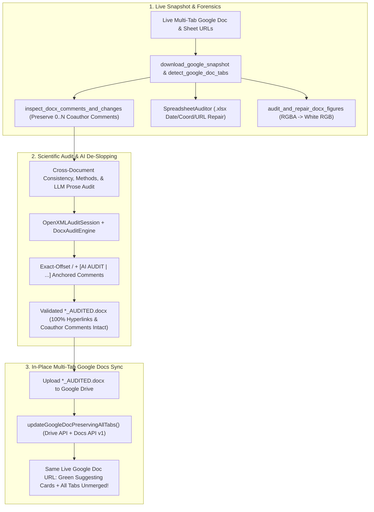

# Manuscript Audit Toolkit v2.0 🔬📑

[](https://www.python.org/downloads/)
[](https://opensource.org/licenses/MIT)
[](https://en.wikipedia.org/wiki/Office_Open_XML)

An end-to-end, non-destructive scientific manuscript auditing, AI-prose de-slopping, spreadsheet/figure forensics, and OpenXML Track Changes + sidebar comment toolkit for **Google Docs** and **Microsoft Word**—preserving **100% of live reference manager links** (Zotero, Paperpile, EndNote), **100% of prior coauthor comments**, and **100% of multi-tab Google Docs hierarchies**.

---

## ✨ What's New in v2.0

1. **Native OpenXML Track Changes (`<w:del>` / `<w:ins>`) + Phrase-Anchored Comments (`DocxAuditEngine`)**:
   - Splits `<w:r>` runs at exact character offsets while cloning `<w:rPr>` formatting (superscripts, italics, bold) and treating `<w:hyperlink>`, `<w:ins>`, `<w:del>`, and `<m:oMath>` as barriers—emitting **1-click green Suggesting-mode edits** in Google Docs alongside phrase-anchored comments.
2. **100% Preservation of Existing Coauthor Comments & Inline Prompts**:
   - Inventories existing `word/comments.xml` (`inspect_docx_comments_and_changes`), preserves all prior coauthor anchors intact, starts new comment IDs strictly at `max(existing_ids) + 1`, and bold-prefixes new headers with **`[AI AUDIT | <CATEGORY>]`** in third-person voice so AI audit comments are unmistakably distinct from human coauthor comments even after Google Docs `.docx` conversion.
3. **Zero-Tab-Merge In-Place Multi-Tab Google Docs Updater (`google_apps_script/update_google_docs_preserve_tabs.gs`)**:
   - Updates a live multi-tab Google Doc **in place** (preserving its exact URL, File ID, sharing permissions, and Version History) **without flattening its tabs**: snapshots the live tab hierarchy via Google Docs REST API v1 (`?includeTabsContent=true`), updates the Main Manuscript tab from the audited `.docx`, restores its tab title/emoji (`UpdateDocumentTabPropertiesRequest`), and recreates + deep-clones all remaining tabs and nested child sub-tabs (`AddDocumentTabRequest` + `DocumentApp`) from an automatic `[PRE-AUDIT MULTI-TAB BACKUP]`.
4. **Programmatic Spreadsheet Forensics (`SpreadsheetAuditor`)**:
   - Scans `.xlsx` Supplementary Tables for Excel auto-date corruption of gene symbols (`MARCH1`, `SEPT1`, `DEC1`) and floats, scientific-notation coordinate truncation (`start == end >= 1e8` bp), URL-encoded strings (`%2C`), and `"IN PROGRESS"` / `#REF!` placeholders.
5. **Dark-Mode Figure RGBA Transparency Repair (`audit_and_repair_docx_figures`)**:
   - Detects embedded RGBA PNG figures in `word/media/` with transparent backgrounds (`alpha < 255`) where black axes/text vanish in dark mode and composites them onto solid white RGB `(255, 255, 255)`.
6. **Live Google Snapshot Downloader & Multi-Tab Detector (`google_docs.py`)**:
   - Downloads live `.docx` and `.xlsx` exports directly from link-shared Google Docs/Sheets URLs (`?tab=...` aware) and detects multi-tab documents automatically.

---

## 🏗️ Architecture & End-to-End Workflow



---

## 📦 Installation

```bash
git clone https://github.com/gf777/manuscript-audit-toolkit.git
cd manuscript-audit-toolkit
pip install -e .
```

---

## 🚀 CLI Quickstart

```bash
# 1. Download a live Google Doc snapshot & check if it has multiple tabs
manuscript-audit download \
  --url "https://docs.google.com/document/d/<FILE_ID>/edit?tab=<TAB_ID>" \
  --output manuscript_tab.docx \
  --single-tab \
  --check-tabs

# 2. Inventory existing coauthor comments, Track Changes, & hyperlinks
manuscript-audit inspect --doc manuscript_tab.docx --output prior_comments.json

# 3. Audit & repair Supplementary Tables (.xlsx)
manuscript-audit audit-xlsx \
  --input supplementary_tables.xlsx \
  --output supplementary_tables_AUDITED_FIXED.xlsx \
  --report xlsx_forensics.json

# 4. Repair transparent RGBA figures in a .docx for dark-mode legibility
manuscript-audit fix-figures --doc manuscript_tab.docx --output manuscript_rgb.docx

# 5. Run LLM line-by-line audit & inject native Track Changes + [AI AUDIT] comments
export GEMINI_API_KEY="your-api-key"
manuscript-audit pipeline \
  --input-txt manuscript_tab.docx \
  --doc manuscript_tab.docx \
  --output-docx manuscript_AUDITED.docx
```

---

## 🐍 Programmatic Python API (`OpenXMLAuditSession`)

For surgical, publication-grade manuscript edits with exact phrase matching, inline figure relocation, and 100% preservation of existing coauthor comments and Zotero/Paperpile hyperlinks:

```python
from manuscript_audit import OpenXMLAuditSession, W_NS

with OpenXMLAuditSession(
    input_docx="manuscript_tab.docx",
    output_docx="manuscript_AUDITED.docx",
    author="Manuscript Audit (Antigravity)",
    initials="AGY",
    comment_prefix="AI AUDIT",  # Visually distinguishes AI comments from coauthor comments in Google Docs
) as session:
    P = list(session.engine.body)

    # Inject native <w:del>/<w:ins> Track Change + phrase-anchored [AI AUDIT | ...] comment
    session.engine.apply_phrase_edit(
        P[12],
        target="serves as a testament to the intricate interplay of evolutionary forces",
        replacement="reflects recurrent subtelomeric recombination and GC-biased gene conversion",
        category="AI-PROSE DE-SLOPPING & MECHANISM",
        summary="Replaced generic LLM cliché with concrete evolutionary mechanisms.",
        details="Addresses coauthor request for explicit mechanistic interpretation.",
    )

    stats = session.save()
    print(stats)
```

---

## ☁️ In-Place Multi-Tab Google Docs Upload (Zero Tab Merging)

Open [`google_apps_script/update_google_docs_preserve_tabs.gs`](google_apps_script/update_google_docs_preserve_tabs.gs):

1. Upload your generated `manuscript_AUDITED.docx` to Google Drive (keep it as a `.docx` file).
2. Open the target live Google Doc → **Extensions → Apps Script** → paste `update_google_docs_preserve_tabs.gs` (and set `STAGED_AUDITED_DOCX_NAME` to your `.docx` filename).
3. In the left sidebar under **Services (+)**, add **both** **`Drive API`** and **`Google Docs API`**.
4. Click **Run** (`updateGoogleDocPreservingAllTabs` is selected by default).

Your live Google Doc keeps its **exact URL, permissions, Version History, all prior coauthor comments, all new green Suggesting-mode edits & `[AI AUDIT | ...]` comments, AND all sidebar tabs unmerged** (with an automatic `[PRE-AUDIT MULTI-TAB BACKUP]` saved in Drive).

For autonomous coding/research agents, see [`AGENT_HANDOVER_PROMPT.md`](AGENT_HANDOVER_PROMPT.md) for the complete 6-step protocol.

---

## 📄 License
MIT License. Created by Giulio Formenti.
